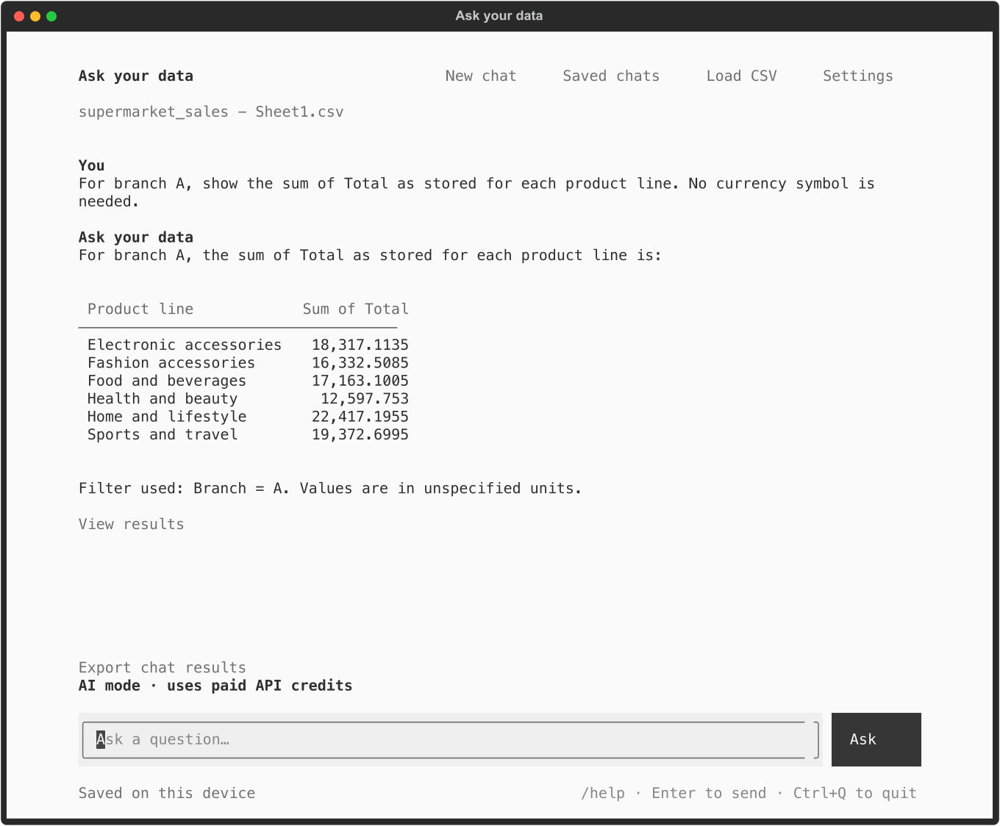
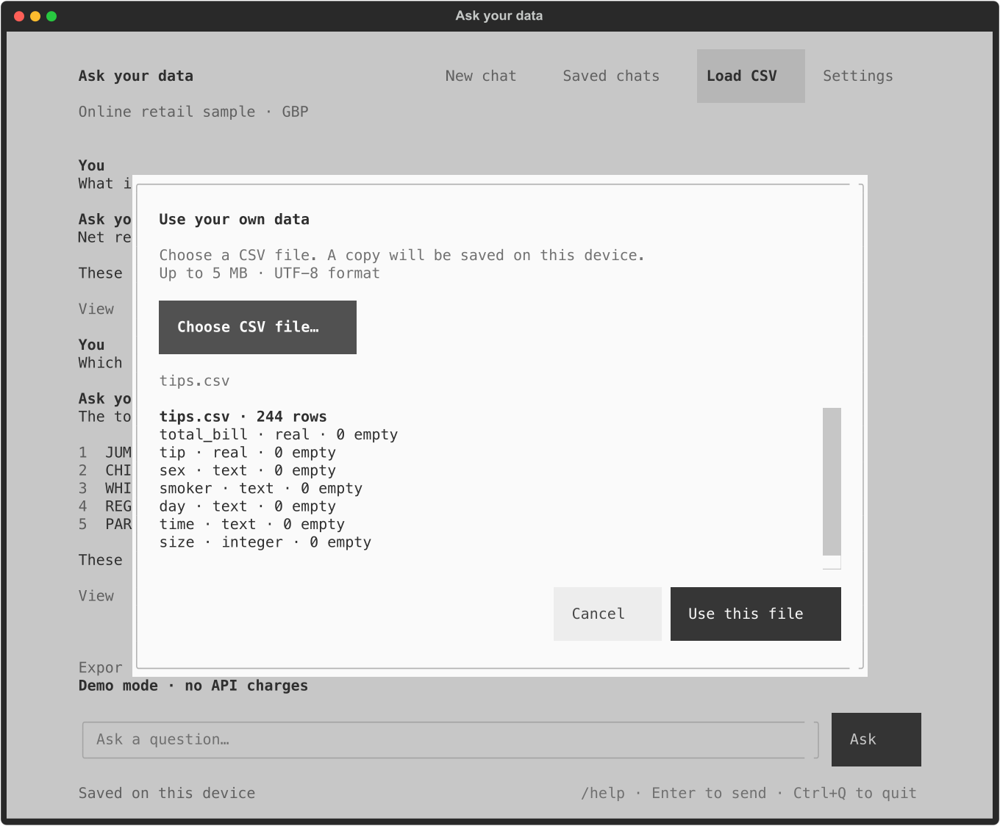
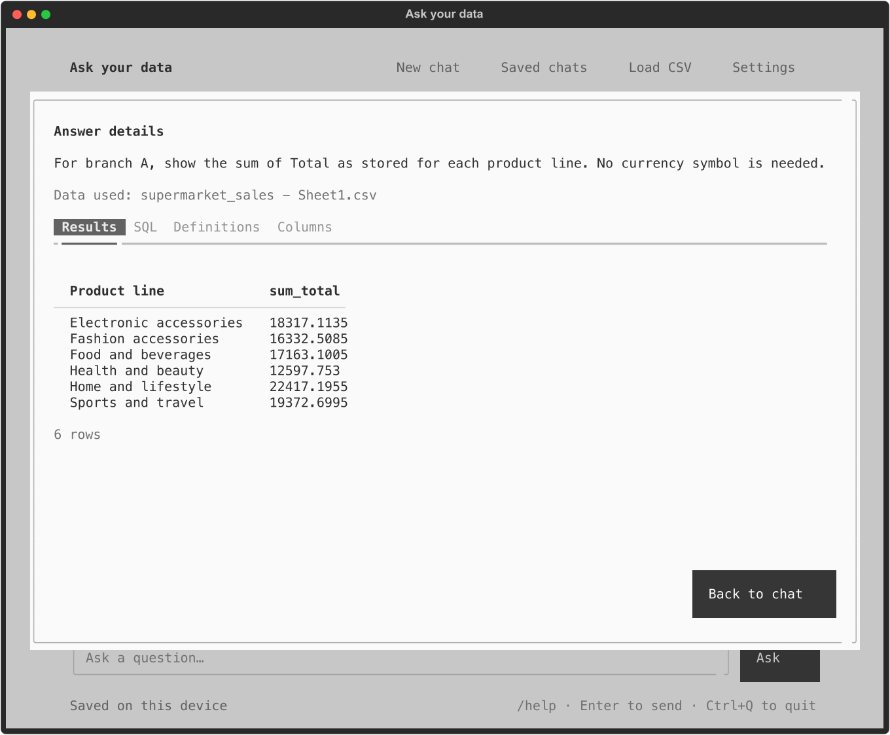
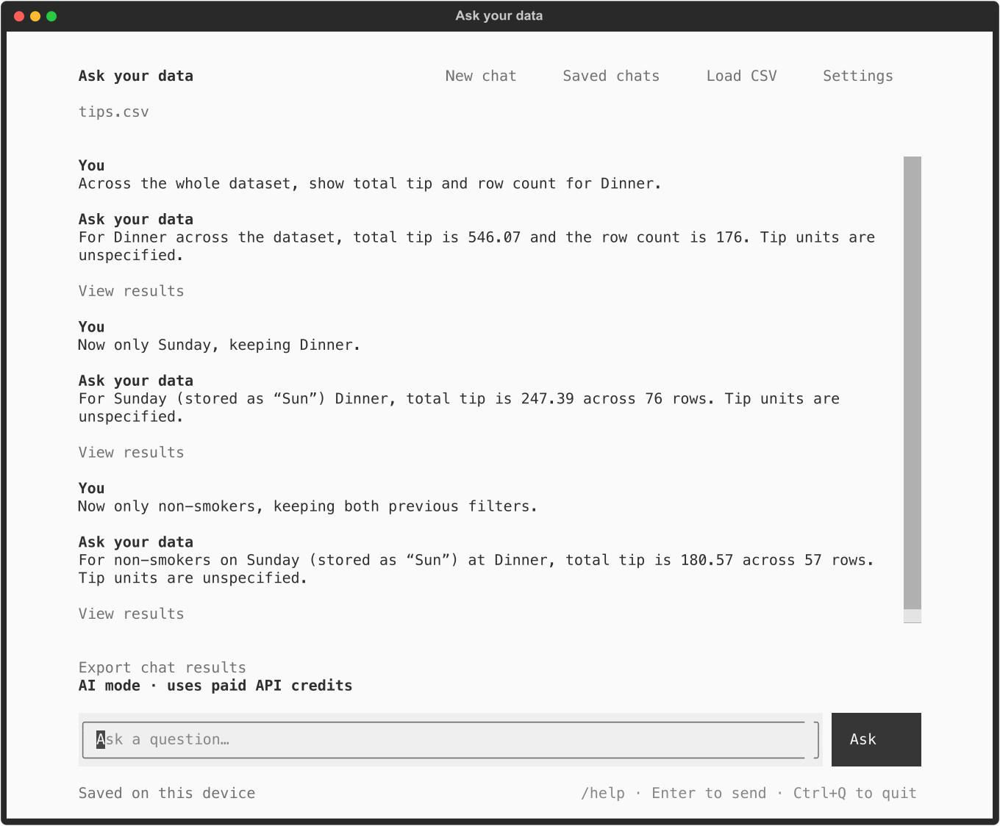
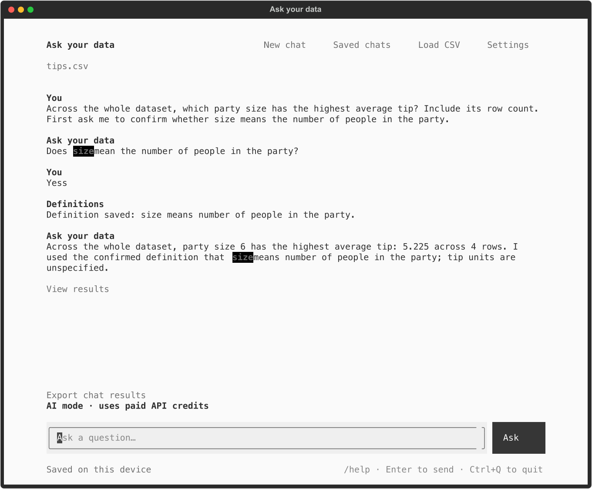

# Ask Your Data

**Ask questions about a CSV, follow up in plain English, and inspect the SQL behind each answer.**

A local terminal app built with **Python, Textual, SQLite, SQLGlot and the OpenAI Agents SDK**.
Try the bundled retail demo without an API key, or connect your own OpenAI API account
for broader questions about your data. Chats, imported data and confirmed column meanings
are stored on your computer.

**Explore without installing:** [PDF walkthrough](docs/ask-your-data-walkthrough.pdf) ·
[All 12 screenshots](screenshots/) · [Architecture](docs/architecture.md)



*An AI answer over an imported supermarket CSV. The values are shown as stored, with no assumed currency.*

## A quick visual tour

### 1. Bring your own CSV

Select **Load CSV**, choose a file in the macOS file window, then review its row count,
inferred column types and empty-cell counts before selecting **Use this file**.
The source file stays unchanged; the app keeps an imported copy.



### 2. Inspect the evidence for each answer

Every answer that ran a query has its own **View results** button. The detail view
contains the saved result rows, executed SQL, definition sources and dataset columns.
Follow-up answers have their own evidence; clarification-only replies have no results button.



[See the SQL tab](screenshots/07-answer-sql.png). A successful query still needs a sensible
interpretation: the evidence is available so you can check it.

### 3. Refine an analysis through follow-ups

AI mode can carry earlier filters into a follow-up. This tested sequence narrows Dinner
to Sunday dinner, then to non-smokers while retaining both earlier filters.



### 4. Clarify a meaning once and reuse it

When the assistant proposes a column meaning and you clearly confirm it, the app saves
that definition with the dataset. It is reused across chats and restarts, and remains
editable in **Settings → Data definitions**. Exact re-uploads reuse the saved dataset.



The example confirms that `size` means the number of people in the party. The result is
**size 6, average tip 5.225, across 4 rows**. Qualified replies such as “yes, but only for
branch A” are not saved as general column definitions.

### More of the experience

| Feature | What it does | Screenshot |
| --- | --- | --- |
| Free demo | Bundled retail questions work without credentials | [Demo answers](screenshots/02-retail-demo-answers.png) |
| Visible progress | Shows your question and “Thinking…” immediately; lets you draft the next question while sending is disabled | [Loading and drafting](screenshots/05-thinking-and-draft.png) |
| Formatted answers | Renders Markdown tables, bold text and code while preserving the saved answer | [Formatted answer](screenshots/04-ai-formatted-answer.png) |
| Local chat history | Reopen conversations labelled with their datasets | [Saved chats](screenshots/11-saved-chats.png) |
| Export all results | Choose a destination, review the export, then save or cancel | [Export confirmation](screenshots/10-export-confirmation.png) |
| Your own AI account | Enter your key and model; connection testing is optional | [AI setup](screenshots/12-connect-your-own-ai.png) |

The screenshots are captures from the actual Textual renderer at 110×44 characters.
AI examples replay answers from successful live evaluations, with their SQL results
rechecked locally. The waiting state uses a controlled delay. The native Finder windows
are not pictured. [Capture notes and captions](screenshots/manifest.json) describe each image.

## Run locally

Use **Python 3.11+**; the clean-install check used **Python 3.12** on macOS.
Native CSV selection and export destination selection currently require macOS.

From the repository root:

```bash
python3.12 -m venv .venv
source .venv/bin/activate
python -m pip install -r requirements.txt
python app.py
```

Already installed? Run `.venv/bin/python app.py`, or double-click
`Start Chatbot.command` in Finder. A fresh installation starts in Demo mode.
No API key is required. The interface supports 80×24 terminals; a larger window gives
results more room. Keep the terminal focused when using VS Code. **Ctrl+Q** exits,
including from dialogs; **Escape** closes dialogs.

### Questions to try

| Dataset / mode | Example question |
| --- | --- |
| Bundled retail, Demo | What is the total revenue? |
| Bundled retail, Demo | Show monthly revenue |
| Bundled retail, Demo | Which five products generated the most revenue? |
| Bundled retail, Demo | Show revenue by country |
| Bundled retail, Demo | How many orders are there? |
| Any imported CSV, either mode | Describe my data |
| Any imported CSV, either mode | Show columns / Show missing values |
| `tips.csv`, AI | Across the whole dataset, show total tip and row count for Dinner. |
| `tips.csv`, AI follow-up | Now only Sunday, keeping Dinner. |
| Supermarket CSV, AI | For branch A, show the sum of Total as stored for each product line. No currency symbol is needed. |

Demo mode recognizes a limited set of questions and common variations. General
natural-language analysis and conversational follow-ups require AI mode. Unsupported
demo questions receive an explanation rather than an invented answer. Basic CSV
inspection works locally in either mode, without an API call.

## Optional AI mode: use your own key

**Cloning this repository does not give you the author's API key.** Each person supplies
their own key and uses their own OpenAI API credits. Demo mode remains free of API calls.

Install the optional integration:

```bash
python -m pip install -r requirements-agent.txt
cp .env.example .env
```

Edit the local `.env` with `OPENAI_API_KEY` and `OPENAI_MODEL`, using an API model ID
available to your account. The development live evaluations used `gpt-6-luna`.
The example file contains no credential, and `.env` is ignored by Git.

Alternatively, open **Settings → AI connection** and enter the key and model there.
Select **Use AI** when ready. **Test connection** is optional and makes a paid API call
against disposable test data; it does not send your imported CSV. It checks tool wiring,
not general answer accuracy.

Mode and model are remembered locally. Keys entered in the dialog stay in memory for
that session only. To restore AI mode after restarting without re-entering the key,
configure it in `.env` or the environment. With valid configuration, startup does not
require another connection test or make an API call. If the key is missing, the app
starts in Demo with a setup notice. The saved model takes precedence over `OPENAI_MODEL`.

AI mode sends questions, limited recent context, schema, definitions, bounded category
values and query results to the configured OpenAI API. It can incur API charges and
does not use Codex sign-in. Trace export is disabled. CSV import, definition storage,
basic local inspection and explicit `/sql` commands do not call a model.

## Data, persistence and export

| Boundary | Current behaviour |
| --- | --- |
| CSV input | One active UTF-8, comma-separated file per chat; up to 5 MB, 50,000 rows, 100 columns and 10,000 characters per cell |
| Validation | Trims surrounding header spaces; rejects duplicate headers, malformed row widths and invalid encoding |
| Types | Preserves leading-zero identifiers as text; blank/whitespace cells become NULL; dates remain text; literal `N/A` remains text |
| Custom CSV table | `records`; quote column names containing spaces or special characters |
| SQL | Validated read-only queries, restricted functions, execution timeout and bounded output; at most 100 returned rows |
| Meanings | Currency and business definitions are not assumed; saved definitions are versioned per dataset |
| Storage | `data/private/` contains chats, imported copies and SQLite databases; ignored by Git, with no automatic cloud backup |
| Portability | `--home /path/to/folder` selects another storage location; definitions are local, not shared between installations |

**Chat history.** Changing the active dataset preserves older answers with their original
evidence and excludes them from the new dataset's model context. Unused new chats are
removed when leaving them; submitted messages and imported datasets are retained.
Unsent drafts survive chat switching within the current session. Your next draft is
never sent automatically when an answer finishes.
Failed or cancelled answers save a short explanation with the submitted question.
Queries, CSV preview/import and exports run in background threads so the interface
can keep responding while they finish.

**SQL support.** Most native SQLite analytical functions are available: text and
formatting, dates, math, JSON/JSONB, aggregates and all built-in window functions.
Joins, subqueries, non-recursive CTEs, set operations, aggregate filters, window
frames and `VALUES` work too. JSON table functions can expand values from your
dataset. Optional functions such as math, median and percentiles depend on your
installed SQLite build; AI mode receives the actual permitted function list.

The function policy uses SQLite's native built-in catalog and safety flags, rather
than a small list of SQLGlot expression names. Extension/custom functions, file
access, logging, `randomblob`/`zeroblob`, schema inspection, writes and recursive
queries remain blocked. SQLGlot checks query structure and dataset references;
SQLite authorizes the original SQL's native function names before execution.
Numeric overflow is saved as a labelled `Infinity` or `-Infinity` value with a
warning. Binary results use hexadecimal SQL literals such as `X'4142'`, so JSON
and chat exports remain usable.

**Definitions.** A clear confirmation saves one displayed, structured column proposal.
Unrelated replies and filters do not become definitions. Definitions can also be edited
in Settings, up to 8,000 characters. Edits reset the recent model context for affected
chats; old answers retain their original definition snapshots. Changed CSV contents
create a different dataset. Importer type upgrades preserve the old dataset for earlier
answers and copy confirmed meanings to the updated snapshot. Old clarification messages
without proposal metadata are not learned retroactively.

**Exports.** Select **Export chat results**, choose a destination, then **Save results**
or **Cancel**. The chooser starts at `data/private/exports/` if it exists, otherwise an
existing parent. Cancel or Escape saves nothing and preserves the draft. A new
`chat-results-…` folder contains:

- One CSV for every saved query result, including follow-ups and empty tables.
- `index.csv`, mapping files to questions, answers and datasets.
- `details.json`, recording SQL and whether results were truncated.

Query warnings, including numeric overflow, are retained in `details.json`.

Exports include saved results across datasets in that chat and skip clarification-only
replies. They use a snapshot of the chat, without rerunning queries or calling the API.
Only saved result rows are exported, not the full dataset. NULLs become blank cells;
formula-like text is escaped for spreadsheet safety.

<details>
<summary>Commands and terminal usage</summary>

| Action | Command / control |
| --- | --- |
| New chat | Ctrl+N or `/new` |
| Choose CSV | Load CSV or `/load` |
| Restore bundled sample | `/sample` |
| Preview imported rows | `show data` |
| Count imported rows | `how many rows` |
| Run checked SQL locally | `/sql SELECT * FROM records LIMIT 10` |
| Help | `/help` |
| Force a mode at launch | `python app.py --ai` or `python app.py --demo` |
| Paid connection check | `python app.py --check-ai` |

```bash
python app.py --ask 'What is the total revenue?'
# Reuse the returned chat ID:
python app.py --chat CHAT_ID --ask 'Show monthly revenue'
```

`--ask` uses the offline route unless `--ai` is supplied. The connection check uses
disposable data and does not create a normal saved chat.

</details>

## Verification and current limits

**Review fixes checked on 22 October 2026:** **389 automated tests passed**,
including execution coverage for all **139 permitted native functions/operators**
and four JSON table functions on the installed SQLite 3.53.1 build, blocking-work UI
responsiveness, interrupted answers and the other review regressions. The offline
retail evaluation passed **12/12** and the tips evaluation passed **19/19**.
These checks used temporary data and mocked AI calls; no new paid live evaluation
was run for these fixes.

**Development checks completed on 21 October 2026:**

| Check | Result | What it establishes |
| --- | --- | --- |
| Automated suite | **153 passed** in a fresh Python 3.12 environment | Local logic, persistence, SQL restrictions, SDK mocks and headless UI behaviour |
| Offline retail evaluation | **12/12 passed** | Deterministic sample answers against independent references |
| Tips CSV evaluation | **19/19 passed** | CSV/Decimal references, filtering, empty results, exports and persistence |
| Live AI: tips | **6/6 passed** | Follow-up filters, confirmation and definition reuse in a fresh chat/store |
| Live AI: retail | **3/3 passed** | Total revenue, France follow-up and declining profit without costs |
| Live AI: supermarket | **3/3 passed** | Leading branch, branch-A product totals and most-used payment method |
| Fresh installation | Passed; no broken dependency requirements | Offline query, reopening a chat in a new process and missing-key handling |

The 12 live cases used the configured `gpt-6-luna` model. Answers and SQL were reviewed
alongside the automated checks. The runs reported **28 model requests, 52,536 input
tokens and 2,025 output tokens** in total. One tips query used an incorrect table name,
was rejected, and was repaired before the final answer. These are small development
regressions, **not a general accuracy benchmark or a guarantee for arbitrary CSVs**.

The current milestone is complete. The user has manually confirmed that the native
macOS file picker opens correctly. Automated tests separately cover selection and
cancellation behaviour using substitutes for the native dialogs.

Run the local checks without paid model calls:

```bash
python -m pip install -r requirements-dev.txt
python -m pytest -q
python -m evaluation.evaluate
python -m evaluation.evaluate_tips
```

<details>
<summary>Run the optional paid live evaluation</summary>

Preview questions and independently calculated references without API calls:

```bash
python -m evaluation.evaluate_live --suite tips
```

Explicitly run the live suite:

```bash
python -m evaluation.evaluate_live --live --suite tips --max-questions 6
```

Suites are `tips` (6), `retail` (3), `supermarket` (3), and `all` (12). The default
six-question cap still applies to `all`; choose `--max-questions 12` to run all cases.
The CSVs must be present in `data/sample/`. The runner uses disposable storage and
the configured key/model, with an optional `--model` override.

It stops at the first failed check, missing usage or exhausted question limit.
`--token-stop 30000` and `--seconds-stop 480` stop starting new questions after the
thresholds are reached; an in-flight question can exceed them. These are not hard
spending limits. There are no automatic suite reruns or provider retries.

Ignored `evaluation/results/live-*.json` reports contain questions, references, answers,
SQL/results, errors, latency, reported usage and dataset/code hashes. Partial results
are saved as the run proceeds. Unreported usage after an API failure is marked
incomplete, not free. No API key is written to the reports. Read the SQL and prose as
well as the pass/fail result; numerical agreement does not prove correct interpretation.

</details>

## Sample data and project notes

The bundled sample derives from **Daqing Chen (2015), Online Retail**,
[UCI Machine Learning Repository](https://archive.ics.uci.edu/dataset/352/online-retail),
[DOI 10.24432/C5BW33](https://doi.org/10.24432/C5BW33), under
[CC BY 4.0](https://creativecommons.org/licenses/by/4.0/).

It retains the first 25 ordinary and 5 cancellation invoices per month, with all their
lines, from December 2010 to December 2011. It contains **6,224 lines and 390 invoices**.
Net invoiced revenue is signed quantity × unit price in GBP, excluding negative prices
and retaining credits: **£117,058.55**. This deliberately selected sample does not
represent full-retailer revenue or trends. See the [sample provenance](data/sample/README.md),
[data manifest](data/sample/manifest.json), [dictionary](data/knowledge/data_dictionary.md)
and [business rules](data/knowledge/business_rules.md).

The screenshots also use the supplied `tips.csv` and `supermarket_sales - Sheet1.csv`
fixtures. The [screenshot catalogue](screenshots/manifest.json) records capture provenance.
The [PDF walkthrough](docs/ask-your-data-walkthrough.pdf) is intended for reviewing
the product without running it. To rebuild it separately from the app, install
`reportlab` and run `python scripts/build_walkthrough.py`.

## Future improvements

These are possible extensions beyond the completed current milestone:

- **Broader evaluation:** more held-out questions, unfamiliar datasets and messy-data fixtures.
- **More platforms:** native file selection and export dialogs for Windows and Linux.
- **Visual analysis:** optional charts alongside answer tables, with the underlying results still inspectable.
- **Model comparisons:** compare answer quality, latency and reported token usage across supported models.
- **Larger schemas:** evaluate retrieval against the current full-schema approach before adding embeddings or reranking.

See [architecture and boundaries](docs/architecture.md). The walkthrough PDF and
architecture document live together in `docs/`; all current images live in `screenshots/`.
No software licence has been added to this repository.
